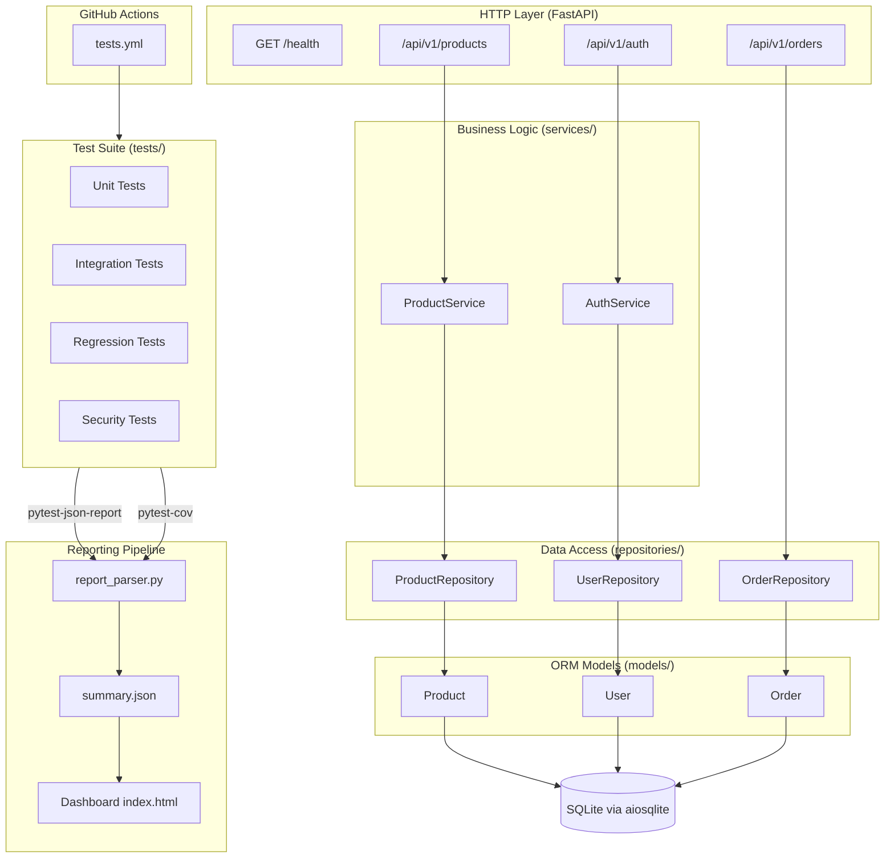

# TestForge — Architecture

## Overview

TestForge is built around two concerns: **a sample REST API** (the "application under test") and **a testing framework** that verifies it. Both live in the same repository to make the testing process fully reproducible.

---

## Architecture Diagram



---

## Layer Responsibilities

### HTTP Layer — `app/api/`
FastAPI routers translate HTTP requests into service calls and HTTP responses. No business logic lives here. Validation of incoming request bodies is handled by Pydantic schemas before reaching the router handler.

### Business Logic — `app/services/`
Services implement the rules of the application:
- `ProductService` enforces price > 0, stock ≥ 0, no duplicate names, and pagination bounds.
- `AuthService` manages user registration, bcrypt password verification, and JWT token issuance.

Services do not import SQLAlchemy directly — they delegate all database access to repositories.

### Data Access — `app/repositories/`
Repositories contain all SQLAlchemy queries. Using parameterised ORM queries prevents SQL injection by construction. Repositories accept a session injected from FastAPI's dependency system, which makes them straightforward to test with an isolated in-memory database.

### Models — `app/models/`
SQLAlchemy ORM models define the database schema. The `Base` class is shared across all models and used by `init_db()` to create tables.

### Schemas — `app/schemas/`
Pydantic v2 models define request and response shapes. Validators run at schema construction time, so invalid inputs are rejected before any service or database code is reached.

### Database — `app/database.py`
The application uses SQLite for demonstration (zero-configuration, no separate server). The async engine (`aiosqlite`) is created once at startup. Tests override the `get_session` FastAPI dependency with a factory bound to a fresh in-memory engine, so no test ever touches the developer database.

### Configuration — `app/config.py`
A single `Settings` class (pydantic-settings) loads configuration from environment variables or an optional `.env` file. The `get_settings()` function is `@lru_cache`-decorated so the same instance is returned everywhere.

---

## Test Architecture

| Layer | What it tests | Database |
|---|---|---|
| Unit | Schema validators, service business rules, JWT helpers | In-memory SQLite (via `session` fixture) |
| Integration | Full HTTP request/response cycle through the API | In-memory SQLite (via `client` fixture) |
| Regression | Each confirmed defect has one or more tests | In-memory SQLite |
| Security | Input validation, auth enforcement, error response safety | In-memory SQLite |

Each test function receives a completely fresh database via `pytest-asyncio` fixtures. Tests are order-independent by design: no test relies on state left by a previous test.

---

## Reporting Pipeline

```
pytest run
  ├── pytest-html    → reports/test_report.html
  ├── pytest-cov     → reports/coverage.json + reports/coverage_html/
  └── pytest-json-report → reports/test_results.json

reporting/report_parser.py
  └── reads test_results.json + coverage.json
  └── writes reports/summary.json

dashboard/index.html
  └── fetches reports/summary.json via fetch()
  └── renders live data into the UI
```

---

## Key Design Decisions

| Decision | Rationale |
|---|---|
| SQLite | Zero-configuration, portable, suitable for demo/portfolio; easily swapped for PostgreSQL in production |
| Async SQLAlchemy + aiosqlite | Consistent with FastAPI's async model; tests run the same code path as the server |
| Dependency injection for sessions | Enables complete test isolation without mocking; the test client swaps the session factory, not individual queries |
| bcrypt (direct) instead of passlib | passlib 1.7.4 is incompatible with bcrypt 5.x; using bcrypt directly removes the version sensitivity |
| Static HTML dashboard | No Node.js build tooling required; reads a JSON file; works offline and in CI artefacts |
| pytest-asyncio `asyncio_mode=auto` | Eliminates `@pytest.mark.asyncio` boilerplate on every async test function |
